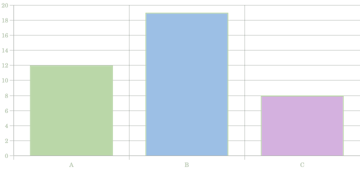

# Based Plugin-Handbuch

Version 1.0.1 · API-Stand Based 0.5 · Stand 17. Oktober 2026

Dieses Paket enthält eine vollständige Plugin-Dokumentation, zwei importfertige Plugins und ihre lesbaren Quellen: einen **3MF-Viewer mit Three.js** und ein **Chart-Plugin mit Chart.js und eigener UI**. Es enthält keine zweite vollständige Source-Code-Ausgabe der App. `based-plugin-api.d.ts` liefert zusätzlich Typen und Autovervollständigung für Editoren und KI-Werkzeuge. Der kleine Host-Patch für eingebettete 3MF-Texturen liegt separat bei.

## Inhalt und Wegweiser

1. Schnellstart und Voraussetzungen
2. Was ein Plugin ist und wo sein Code läuft
3. Paketaufbau, Installation und Bibliotheken
4. Vollständige Plugin-Schnittstelle
5. Dateivorschauen und Dateizugriff
6. Markdown-Blöcke und Transformationen
7. Actions als Liste
8. UI, HTML und CSS-Kapselung
9. Events und Kommunikation
10. Lebenszyklus und Aufräumen
11. Zustand, Speichern und Grenzen
12. 3MF-Plugin: Aufbau, Benutzung und Erweiterung
13. Chart-Plugin: Aufbau, UI und Datenformat
14. Node.js, npm, Build und Tests
15. Fehlersuche und Entwicklung mit einer KI
16. Vollständige Quelltexte und Quellen

## 0. Normaler App-Start und optionaler Test

Based bleibt eine Electron-App. Die HTML-/CSS-/Library-API läuft innerhalb ihres Fensters. Der separate Playwright-Browsertest ist eine Entwicklerprüfung, kein Startweg für den Editor und keine Umwandlung in eine Website.

Im vorhandenen Electron-Projekt `npm start` verwenden. Im Plugin-Kit startet `npm start` ebenfalls die benachbarte Electron-App, sofern sie im übergeordneten Ordner oder daneben unter `based` liegt. Andernfalls den Projektpfad übergeben: `npm start -- /absoluter/Pfad/zur/App`. Das Plugin-Kit ist kein zweiter Editor.

Für den normalen Betrieb sind weder Playwright noch ein separat installierter Chromium-Browser erforderlich. Diese Abhängigkeiten werden nur für die optionalen Tests benutzt. In den Tests wird kein Software-Grafikmodus mehr erzwungen. Bei einem Initialisierungsfehler werden Plugin-Meldungen und eine Diagnose unter `validation/browser-failure.json` gespeichert. Ein bloßer Timeout belegt nicht, dass die Electron-App defekt ist; er zeigt, dass die Test-Initialisierung nicht erfolgreich abgeschlossen wurde.

## 1. Schnellstart

Du brauchst für die fertigen Plugins **kein npm und keinen Build**. Entpacke das Paket an einen Ort, an dem es bleiben kann. In Based: **Plugin importieren** → `plugins/three-mf/three-mf.mjs`. Für Diagramme entsprechend `plugins/chart/chart.mjs`. Die gleichnamige CSS-Datei muss daneben liegen. Das Chart-Plugin erzeugt drei Buttons; der Viewer erzeugt einen zusätzlichen Anhang-Button. Das bestehende „Dateien anhängen“ funktioniert weiterhin.

Anschließend `fixtures/cube.3mf` an eine gespeicherte Notiz anhängen. Based kopiert die Datei neben die Notiz und schreibt einen relativen Verweis. Für Charts einen der drei Diagramm-Buttons drücken oder den Block aus Abschnitt 13 einsetzen. `fixtures/demo.md` und die zugehörigen Dateien können gemeinsam als Testordner geöffnet werden.

### Host-Voraussetzung

Erforderlich ist der Based-Host aus Version 0.5 mit `files`, `render`, `mount`, Datei-Hilfsmethoden, Events und lokalen ES-Modulen. Nur die Plugin-Datei in einen älteren Host zu kopieren reicht dafür nicht.

Für 3MF-Dateien mit eingebetteten Texturen braucht der Host zusätzlich `blob:` in seiner `img-src`-Regel. ThreeMFLoader erzeugt lokale Blob-URLs für solche Bilder. Der Patch verändert ausschließlich diese CSP-Regel und legt vorher eine Sicherung an:

```sh
node host-update/enable-blob-images.mjs /absoluter/Pfad/zu/based
```

Danach im bestehenden Based-Projekt `npm run build` ausführen und die App neu starten. Ohne Texturen ist der Patch für den mitgelieferten einfachen Würfel nicht erforderlich. Eine bereits verteilte DMG muss aus dem aktualisierten Host neu gebaut werden. Der Patch erfindet keine neue Plugin-API und schaltet weder Remote-CDNs noch Node-Zugriff frei.

## 2. Das Ausführungsmodell

Ein Plugin ist ein JavaScript-ES-Modul mit genau einem `export default`-Objekt. Based liest seine Metadaten, registriert Renderer und Buttons und startet seine UI bei Bedarf. Dasselbe Plugin darf gleichzeitig Dateiformate übernehmen, Markdown-Blöcke erkennen und mehrere Aktionen anbieten.

**Node.js ist die Entwicklungs-, Paket- und Testumgebung. Das importierte Plugin läuft im Browser-Kontext von Electron.** Browser-ESM, DOM, Canvas, WebGL, Audio, Video, Fetch und passende WASM-Libraries sind verfügbar. `node:fs`, `require`, native Node-Addons, `child_process`, ein beliebiger Backend-Server und Electron-Main-APIs stehen dem Plugin nicht direkt zur Verfügung. Ein reines Node-Backend braucht eine explizite Host-Erweiterung; ein Bundler kann Betriebssystemfunktionen nicht in Browser-APIs verwandeln.

Der Ablauf lautet: Markdown rendern → Plugin-HTML einfügen → eigenen Shadow Root erzeugen → `mount` aufrufen → Dateien/Library laden → interaktive UI betreiben → bei Entfernung abbrechen und aufräumen. Ein HTML-String allein startet keine Script-Tags. HTML beschreibt die Struktur; JavaScript gehört in `mount` und importierte Module.

## 3. Dateien und Installation

| Pfad | Bedeutung |
| --- | --- |
| `plugins/three-mf/three-mf.mjs` | Importfertiger 3MF-Viewer einschließlich gebündelter Libraries |
| `plugins/three-mf/three-mf.css` | Gekapseltes Viewer-Design |
| `plugins/chart/chart.mjs` | Importfertiges Chart.js-Plugin |
| `plugins/chart/chart.css` | Diagramm- und UI-Design |
| `src/three-mf.mjs` | Lesbare Three.js-Implementierung |
| `src/chart.mjs`, `src/chart-data.mjs` | Lesbare Chart-Implementierung und Schema |
| `fixtures/` | Selbst erzeugte 3MF-Testdateien und Markdown-Beispiel |
| `tests/` | Node- und Browser-Prüfungen |
| `licenses/` | Lizenztexte mitgelieferter Bibliotheken |
| `validation/` | Tatsächlich ausgeführte Prüfungen und Rendering-Artefakte |

Ein selbst geschriebenes Plugin kann nur aus `mein-plugin.mjs` bestehen. Mit einer `mein-plugin.css` daneben wird das Design automatisch mitgeladen. Größere Plugins dürfen `lib/`, `vendor/`, Bilder und andere Ressourcen mitbringen. Relative Imports werden über ein lokales, auf den ausgewählten Plugin-Ordner begrenztes Protokoll geladen. Unterordner bleiben zusammen mit dem Einstieg erhalten. Verweise auf `../` außerhalb dieses Ordners werden blockiert; Symlinks sind kein Ausweg aus der Begrenzung.

Importierte Plugins gelten aktuell **für die Sitzung**. Nach einem App-Neustart erneut importieren. Ein Import derselben ID ersetzt die vorhandene Registrierung, ohne automatisch deren Position in der Pipeline zu ändern. Bereits aktive Datei- und Fence-Ausgaben werden neu ausgewertet. Persönliche CSS-Anpassungen können einen neuen CSS-Standard überdecken: im Design-Editor bei Bedarf „Standard“ wählen.

## 4. Vollständiges Plugin-Objekt

| Feld | Typ und Wirkung |
| --- | --- |
| `id` | Pflicht: einfache eindeutige ID, z. B. `three-mf`; Buchstabe zuerst, dann Buchstaben/Ziffern/`-`/`_` |
| `title` | Lesbarer Name, u. a. im Design-Editor |
| `enabled` | Bei `false` keine Verarbeitung und keine Actions |
| `files` | Array von Dateiendungen für eine Dateivorschau |
| `render(file, {escape})` | Synchrones HTML für einen Dateianhang; zusammen mit `files` verwenden |
| `content` | Entweder Funktion oder deklaratives `{fence, render}` |
| `run(text, context)` | Bisheriger synchroner Pipeline-Schritt; Alternative zu `content` |
| `design` | CSS-Metadaten: `css`, `file`, `stylesheets` |
| `actions` | Array mit null, einer oder vielen Aktionen |
| `mount(container, api)` | Optional: UI und asynchrone Initialisierung einer Ausgabe |

Mindestens eine Verarbeitung muss vorhanden sein: `files` + `render`, `content` oder `run`. Ein Objekt nur mit `id` und Actions wird vom gegenwärtigen Validator nicht als Plugin akzeptiert. Falls du nur Textbuttons anbieten möchtest, ergänze eine unverändernde `content: text => text`-Funktion.

Wenn `content` eine Funktion ist, wird sie statt `run` verwendet. Bei deklarativem `content` wird dessen Fence registriert. `mount` ist kein Ersatz für diese Registrierung: es startet erst, wenn eine Ausgabe mit der passenden Plugin-Markierung existiert.

Alle synchronen Renderfunktionen müssen Strings zurückgeben. Kein `async render` und kein Promise als HTML. Asynchrones Laden kommt in `mount`. `render(file, {escape})` bekommt nur diesen kleinen Render-Kontext; die umfangreichen Markdown-Methoden gehören zu `content`/`run`.

### Minimaler Dateihandler

```js
export default {
  id: 'text-preview',
  files: ['txt', 'log'],
  design: { css: 'pre { white-space:pre-wrap; padding:12px; }' },
  render(file, {escape}) {
    return `<h3>${escape(file.name)}</h3><pre>Lade …</pre>`;
  },
  async mount(container, {file, signal}) {
    const text = await file.text();
    if (signal.aborted) return;
    container.querySelector('pre').textContent = text;
  }
};
```

## 5. Dateihandler und Dateizugriff

Based erkennt Dateivorschauen am Anhang-Markdown ``. Auch Audio, Video und sonstige Anhänge verwenden diese Syntax. Ein normaler Link `[Name](./datei.endung)` wird aktuell nicht automatisch zum Datei-Plugin umgeleitet.

`files: ['3mf']` meldet die Endung an. Groß-/Kleinschreibung wird beim Vergleich ignoriert; ein führender Punkt ist optional. MIME-Wildcards wie `audio/*`, ein universelles `*` und reguläre Ausdrücke sind keine unterstützten Matcher. Füge mehrere Endungen in das Array ein. Bei mehreren passenden Plugins gewinnt die zuletzt **hinzugefügte** Registrierung in der Pipeline. Ein erneuter Import einer bestehenden ID ersetzt sie an ihrer bisherigen Position. Ohne Treffer bleibt die Standardvorschau bzw. die allgemeine Dateikarte erhalten.

`files` ist keine Import-Erlaubnisliste. „Dateien anhängen“ akzeptiert alle regulären Dateien, auch unbekannte Endungen. Das Array entscheidet ausschließlich, welcher Renderer die Vorschau übernimmt.

### Das Dateiobjekt

| Eigenschaft / Methode | Bedeutung |
| --- | --- |
| `name` | Aus der URL abgeleiteter Dateiname |
| `extension` | Kleingeschriebene Endung ohne Punkt |
| `label` | Beschriftung aus dem Markdown, sonst Dateiname |
| `src` | Ursprünglicher, meist relativer Markdown-Pfad |
| `url` | In `mount` gegen den Standort der Notiz aufgelöste URL |
| `arrayBuffer()` | Datei vollständig als Binärdaten lesen |
| `text()` | Datei vollständig als Text lesen |
| `blob()` | Datei als Blob lesen |

In `render` ist die URL noch ein Renderwert, häufig relativ. Für Datei-Libraries in der UI **die URL aus `mount`** verwenden. Bei Fence-Plugins ist `file` null. Die Helfer verwenden das Lebenszyklus-Signal, prüfen den HTTP-Status und senden Lade-Events. Wiederholte Aufrufe lesen erneut; es gibt keine zugesicherte permanente Byte-Cache-Schicht.

```js
const bytes = await file.arrayBuffer();
if (signal.aborted) return;
const object = loader.parse(bytes);
```

Oder die Library lädt selbst mit `file.url`. Dann nutzt sie nicht automatisch das AbortSignal der Helfer und erzeugt kein `file:loaded`-Event. Ein Loader mit eigener Abort-Methode muss in `onDispose` abgebrochen werden. Bei eingebetteten Texturen können zusätzliche Bild-Ladevorgänge nach dem synchronen `parse` weiterlaufen; `plugin:ready` bedeutet nicht, dass sämtliche Texturdownloads abgeschlossen sind.

Relative Pfade beziehen sich auf die **Markdown-Datei**, nicht auf das Plugin und nicht auf den aktuell angeklickten Seitenleistenordner. Importierte Dateien liegen direkt neben der Notiz. Pfade mit `../` funktionieren innerhalb des gewählten Stammordners. Für Plugin-Ressourcen dagegen `new URL('./asset.bin', import.meta.url)` verwenden.

## 6. Markdown-Blöcke und Transformationen

```js
export default {
  id: 'counter',
  design: {css: 'button { padding:8px; }'},
  content: {
    fence: 'counter',
    render(text, argument, {escape}) {
      return `<button>${escape(argument || '0')}</button>`;
    }
  },
  mount(container, {data, signal}) {
    let count = Number(data.argument || 0);
    if (!Number.isFinite(count)) count = 0;
    const button = container.querySelector('button');
    button.textContent = String(count);
    button.addEventListener('click', () => {
      button.textContent = String(++count);
    }, {signal});
  }
};
```

Der Block `counter 5` liefert `argument === '5'`; sein Inhalt landet in `text`. `mount` erhält dieselben Werte als `data: {text, argument}`. Eine abschließende neue Zeile gehört häufig zum Blockinhalt. Das Fence wird für jeden Renderdurchlauf neu auf der frischen Markdown-Instanz registriert.

Für Texttransformationen kann `content(text, context)` einen veränderten String zurückgeben. Für eigene markdown-it-Regeln steht `context.markdown` bereit. Der Kontext enthält außerdem `escape`, `meta`, `services`, `wrap` und `renderFile`. `meta` teilt Daten innerhalb eines Durchlaufs; es ist kein persistenter Zustand. Der Standardhost stellt unter `services.katex` KaTeX bereit. Es gibt keine allgemeine Zusage über zusätzliche Services.

Eigene HTML-Regeln verwenden `context.wrap(html, {block:true, data:{...}})`. Dadurch landet die Ausgabe unter der Plugin-ID im eigenen CSS-Bereich und `mount` erhält die JSON-kompatiblen Daten als `api.data`. Ohne diesen Wrapper wird der Plugin-Lifecycle nicht automatisch zu beliebigem HTML zugeordnet. Funktionen, DOM-Knoten oder zyklische Objekte sind keine geeigneten `data`-Werte.

## 7. Actions sind eine Liste

Ein Plugin kann **beliebig viele Buttons** definieren. Chart liefert beispielsweise Balken, Linie und Ring. Das frühere Medien-Plugin durfte Foto, Video und Audio als drei Actions enthalten. Kein zusätzliches Plugin und keine Änderung des Host-Quellcodes ist dafür nötig.

```js
actions: [
  {id:'bar', label:'Balkendiagramm', insert:() => chartMarkdown('bar')},
  {id:'line', label:'Liniendiagramm', insert:() => chartMarkdown('line')},
  {id:'ring', label:'Ringdiagramm', insert:() => chartMarkdown('doughnut')}
]
```

Jede Action braucht eine innerhalb dieses Plugins eindeutige, nichtleere `id` und einen `label`. Dazu kommt `insert` oder `command`. IDs verschiedener Plugins dürfen gleich sein.

`insert` ist ein String oder eine **synchrone** Funktion mit `{selection, text, now}`. Die Funktion liefert den einzufügenden Markdown-Text zurück. `selection` ist die Auswahl, `text` der aktuelle Gesamttext, `now` ein Date-Objekt. Die Auswahl wird ersetzt; ohne Auswahl wird an der Cursorposition eingefügt. Die eigentliche Datei wird erst mit dem normalen Speichern geändert.

```js
{id:'formula', label:'Formel einfügen',
 insert:({selection}) => '\n$$\n' + (selection || 'E=mc^2') + '\n$$\n'}
```

Die vordefinierte Host-Aktion lautet `command: 'import-media'`. Sie heißt aus Kompatibilitätsgründen weiterhin so, obwohl sie alle Dateien akzeptiert. `kind: 'file'` ist die passende Metadatenangabe. Alte Werte `image`, `video`, `audio`, `all` werden noch akzeptiert; seit dem filterlosen Import öffnet jeder davon denselben vollständigen Dateidialog. Es gibt keine frei erfundenen Commands für Betriebssystemaktionen.

```js
actions: [
  {id:'photo', label:'Foto anhängen', command:'import-media', kind:'image'},
  {id:'video', label:'Video anhängen', command:'import-media', kind:'video'},
  {id:'audio', label:'Audio anhängen', command:'import-media', kind:'audio'}
]
```

Eine Action-`insert`-Funktion ist kein asynchroner UI-Callback. Für Formulare, Optionen, Regler und komplexe Werkzeuge einen Inhalt oder Dateianhang mit `mount` und eigenen DOM-Buttons erzeugen.

## 8. Eigene UI, HTML und CSS

`container` ist der offene Shadow Root genau dieser Ausgabe. `querySelector`, `append`, `replaceChildren` und normale DOM-Methoden funktionieren. Mehrere Instanzen desselben Plugins haben getrennte Container. Verwende `container.querySelector(...)` statt globalem `document.querySelector(...)`.

HTML aus den Renderfunktionen wird bereinigt. Externe Werte mit `escape` in HTML einsetzen oder später über `textContent` setzen. Inline-`onclick` und Script-Tags sind nicht der Startmechanismus. In `mount` `addEventListener` verwenden. Auch Code, der später `innerHTML` benutzt, muss fremde Daten selbst korrekt behandeln: `mount` ist vertrauenswürdiges JavaScript, keine automatische zusätzliche HTML-Sicherheitsprüfung.

### Design-Priorität und Ressourcen

1. Persönliche CSS-Anpassung im Design-Editor hat Vorrang.
2. Beim externen Import wird die gleichnamige CSS-Begleitdatei als Plugin-CSS geladen.
3. Ohne Begleitdatei kann `design.css` einen CSS-String enthalten.
4. Eingebaute Plugins können `design.file` über den internen CSS-Katalog auflösen.

Für eigene externe Pakete die Dateien gleich benennen: `chart.mjs` + `chart.css`. Ein frei gewähltes `design.file: 'anders.css'` veranlasst den externen Importer nicht zum beliebigen Lesen dieser Datei.

Mit `design.stylesheets` sind zusätzliche Stylesheets möglich. Relative URLs werden beim Plugin-Import auf den Plugin-Einstieg bezogen. Für CSS mit weiteren relativen Bild-/Font-URLs ist ein richtiges externes Stylesheet zweckmäßig. Der als String eingefügte CSS-Begleittext hat keine eigene ursprüngliche Datei-URL; `url('./icon.svg')` darin bezieht sich ansonsten auf die Hostseite. Verwende deshalb aufgelöste URLs oder ein zusätzliches Stylesheet mit eigener URL.

```js
design: {
  css: ':host { display:block; }',
  stylesheets: [new URL('./theme.css', import.meta.url).href]
}
```

Ein `strong { ... }` innerhalb eines Plugins verändert keine Markdown-Überschrift und kein anderes Plugin. Normale geerbte Typografie wird bewusst weitergegeben; für eigene Größen explizite Werte setzen. CSS-Variablen eignen sich für einfache Designoptionen. Bei einer Datei-Ausgabe den Host für große UI mit `:host {display:block}` setzen. Ein Fence bekommt bereits eine Block-Markierung.

Bibliotheken müssen mit DOM-Elementen im Container arbeiten können. Tooltip-Portale, die an `document.body` angehängt werden, verlassen den CSS-Bereich. Chart.js verwendet hier seine Canvas-Tooltips und eine eigene `.canvas-area` mit fester Höhe. Three.js bekommt ein eigenes `.viewport`-Element; seine Canvas-Größe wird über ResizeObserver angepasst.

Tastaturbedienung, `aria-label`, verständliche Buttons, sichtbarer Fokus und verständliche Fehlermeldungen gehören zur Plugin-UI. Vermeide automatische globale Tastatur-Shortcuts und globale CSS-Regeln. In diesem Paket sind alle Styles lokal und UI-Ereignisse an das AbortSignal gebunden.

## 9. Events

| Event | Zeitpunkt / Daten |
| --- | --- |
| `file:attached` | Global nach Import; `{files}` mit den importierten Einträgen |
| `render:mounted` | Container eingefügt; asynchrones mount kann noch laufen |
| `file:loaded` | Datei-Helfer erfolgreich; `{file}`, bei arrayBuffer zusätzlich `bytes` |
| `file:error` | Datei-Helfer fehlgeschlagen; `{file, message}` |
| `plugin:ready` | mount einschließlich seines zurückgegebenen Promise abgeschlossen |
| `plugin:error` | Runtime-Initialisierung oder Cleanup fehlgeschlagen; Nachricht und Plugin-ID |
| `render:disposed` | Instanz entfernt, Signal abgebrochen |

`on(name, callback)` abonniert die eigene Instanz. `emit(name, detail)` sendet lokal und auf dem gemeinsamen Bus. Instanz-Ereignisse erhalten ihre `plugin`-ID. Eigene Felder dürfen daher nicht versuchen, diese ID zu ersetzen. Die API garantiert keine automatische einzigartige Instanz-ID; falls mehrere Instanzen unterschieden werden müssen, in mount `crypto.randomUUID()` erzeugen und in eigene Events aufnehmen.

`events.on/emit` ist der gemeinsame Bus. Globale Abonnements explizit mit dem Lifecycle verbinden:

```js
mount(container, {events, onDispose, emit}) {
  const instanceId = crypto.randomUUID();
  const off = events.on('settings:changed', detail => {
    container.host.dataset.theme = detail.theme;
  });
  onDispose(off);
  emit('viewer:ready', {instanceId});
}
```

`on` und `events.on` geben Abmeldefunktionen zurück. Lokale Listener werden beim Entfernen zusätzlich geleert. Ein Listenerfehler soll nicht alle anderen Listener anhalten; verlasse dich deshalb nicht darauf, dass Event-Callbacks als zentrale Fehlerbehandlung Ausnahmen weiterwerfen. Erwartbare UI-Fehler am Bedienfeld anzeigen. Events sind Mitteilungen, keine automatische Dateispeicherung und keine Bestätigung einer externen Aktion.

Im Host stehen `renderer.on(name, fn)` und `renderer.emit(name, detail)` sowie `renderer.events` bereit. Ein Plugin braucht dafür aber keinen Zugriff auf eine globale Renderer-Variable.

## 10. Lifecycle und Cleanup

`mount(container, api)` darf synchron oder asynchron sein. Es kann eine Cleanup-Funktion zurückgeben, oder beliebig viele `onDispose(fn)`-Callbacks registrieren. Das Signal wird vor dem Cleanup abgebrochen. Auch ein spät zurückgegebener Cleanup nach einem bereits entfernten async mount wird noch ausgeführt.

```js
async mount(container, {file, signal, onDispose}) {
  let viewer;
  onDispose(() => viewer?.dispose());
  const bytes = await file.arrayBuffer();
  if (signal.aborted) return;
  viewer = createViewer(container, bytes); // konkrete Library-Funktion
}
```

`createViewer` ist in diesem Rezept bewusst ein Platzhalter für deine konkrete Library; die beiden echten Beispiele darunter haben vollständige Implementierungen.

| Ressource | Cleanup |
| --- | --- |
| DOM-Listener | `{signal}` bei addEventListener oder removeEventListener |
| Timer / Intervalle | clearTimeout / clearInterval |
| requestAnimationFrame | cancelAnimationFrame |
| ResizeObserver | disconnect |
| Globale Events | Rückgabefunktion des Abonnements |
| Chart.js | chart.destroy() |
| Three.js | Loop stoppen, Controls, Texturen, Materialien, Geometrien und Renderer freigeben |
| Eigene Blob-URL | URL.revokeObjectURL |

Registriere Cleanup möglichst früh und mache ihn idempotent. Bei Fehlern nach teilweiser Initialisierung ebenfalls aufräumen. Nach jedem asynchronen Schritt `signal.aborted` beachten. Die Runtime kann fremde Promises oder eine beliebige Library nicht von selbst abbrechen.

Unveränderte Ausgaben werden wiederverwendet, statt bei jedem Tastendruck neu zu laden. Die Identität berücksichtigt u. a. Plugin-ID, HTML, Daten, CSS, Dateipfad und mount-Funktion. Sichtbar gleiche doppelte Ausgaben werden nach ihrer Reihenfolge unterschieden. Verwende das nicht als dauerhafte Datenbank-ID. Änderungen an CSS oder Quell-HTML können eine neue Instanz auslösen. Externe Änderungen an den Dateibytes werden noch nicht automatisch überwacht.

## 11. Zustand, Speichern und echte Grenzen

Markdown-Inhalte bleiben die dauerhafte Quelle. UI-Änderungen im Viewer oder Chart sind zunächst Instanzzustand. Der Host bietet derzeit **keine öffentliche API zum automatischen Zurückschreiben eines Blockes aus mount**. Das Chart-Plugin hat deshalb „Markdown kopieren“ mit manuellem Ersetzen und Speichern. Es behauptet keine automatische Persistenz.

Für persönliche lokale Einstellungen ist namespaced `localStorage` möglich, z. B. `based.plugin.charts.v1`. Diese Daten reisen nicht mit der Notiz und die Plugins teilen den Browser-Kontext. HTML, CSS-Kapselung und lokale Ressourcentokens sind keine JavaScript-Sandbox. Keine vertraulichen Werte in Events oder gemeinsamem Storage voraussetzen.

Es gibt noch keine deklarative Versionsaushandlung, keinen Plugin-Shop, keine dauerhafte automatische Installation, kein garantiertes eigenes Worker-/Node-Backend und keinen allgemeinen Host-Command für Dateilöschung, Shell oder Prozessstart. Zusätzliche Felder im Plugin-Objekt erfinden solche Fähigkeiten nicht. Für neue Betriebssystemfunktionen muss der Host gezielt erweitert werden.

Das Paket benötigt keinen Netzwerkzugriff beim Anzeigen. Browser-Module mit Bare Imports wie `import ... from 'three'` werden vorher gebündelt. Ein Node-only-Paket ist dadurch nicht automatisch kompatibel. Bei Libraries mit Workers, WASM, externen Assets oder Portalen deren konkrete Browser-Anforderungen prüfen und Assets lokal mitliefern.

## 12. 3MF-Viewer mit Three.js

Verwendet werden das npm-Paket `three` und dessen echte Addons `ThreeMFLoader` und `OrbitControls`. Die Versionsnummern sind im package-lock festgehalten. Der Build erzeugt eine einzelne importierbare `three-mf.mjs`; im App-Browser gibt es dadurch keine unaufgelösten Bare Imports und keinen CDN-Zugriff.

Der Viewer übernimmt `files:['3mf']`, liest mit `file.arrayBuffer()`, parst mit `new ThreeMFLoader().parse(bytes)`, dreht die Z-up-Geometrie in die Ansicht und zentriert sie über Box3. Eine PerspectiveCamera, zwei Lichtquellen und OrbitControls erlauben Drehen und Zoomen. Die UI bietet Ansicht zurücksetzen, Drahtgitter und automatische Rotation. ResizeObserver aktualisiert Camera-Aspekt und Renderergröße. Events: `model:ready` und `model:wireframe`.

Der Cleanup stoppt die Renderloop, trennt den Observer und Controls und entsorgt alle gemeinsamen Texturen, Materialien und Geometrien jeweils nur einmal. Der Renderer wird freigegeben. Bei Lade- oder WebGL-Fehlern erscheint eine verständliche Nachricht. Es handelt sich um eine Vorschau, nicht um eine Reparatur- oder Slicer-Anwendung.

ThreeMFLoader unterstützt 3MF-Kernmodelle, Mesh-/Komponentenobjekte und Basismaterialien; Material-/Property-Erweiterungen nur teilweise. Hersteller- und Slicer-Metadaten, proprietäre Erweiterungen, beschädigte ZIP-Dateien und beliebige Projektfunktionen sind daher keine Garantie. Sehr große Dateien werden vollständig gelesen und synchron geparst und können die UI zeitweise beanspruchen. Für Produktions-Großmodelle wären Fortschritt, Limits und gegebenenfalls ein Worker-Ansatz zusätzliche Arbeit.

`fixtures/cube.3mf` ist eine selbst erstellte ZIP-3MF mit Würfelgeometrie. `textured-cube.3mf` enthält zusätzlich eine eingebettete PNG-Textur und dient als Integrationsfixture. `invalid.3mf` prüft den Fehlerweg. Es sind keine fremden Modelle oder Kundendaten enthalten.

Für STL, GLB oder OBJ ergänze einen jeweiligen Loader und eine weitere Endung. Jeder Loader hat seine eigene API: nicht `parse`-Signaturen zwischen Formaten übertragen. Die vollständige 3MF-Implementierung im Anhang ist der funktionierende Ausgangspunkt; kein Pseudocode mit erfundenem Viewer-Konstruktor.

## 13. Chart-Plugin mit UI

Das Chart-Plugin ist **ein Plugin mit drei Actions**, einem Fence und einer eigenen UI. Es verwendet Chart.js `auto`, damit die benötigten Controller und Skalen registriert sind.

````markdown
```chart
{
  "title": "Arbeitsstunden",
  "labels": ["Mo", "Di", "Mi"],
  "values": [4, 7, 5],
  "type": "bar"
}
```
````

`labels` ist ein nichtleeres Array aus Strings. `values` ist ein gleich langes Array endlicher Zahlen. `type` ist `bar`, `line` oder `doughnut`; ohne Angabe `bar`. `title` ist optional. Beliebige Chart.js-Funktionen, Callback-Strings und ausführbare Konfiguration werden nicht aus JSON evaluiert.

Die UI kann den Diagrammtyp wechseln und JSON-Daten anwenden. Ungültiges JSON erzeugt eine lokale Nachricht. Der sichtbare Titel wird aktualisiert. „Markdown kopieren“ erzeugt einen neuen Block; wenn die Clipboard-API nicht verfügbar ist, wird der Text im Editor zur manuellen Kopie markiert. Beim Wechseln des Typs oder Entfernen wird die vorherige Chart-Instanz zerstört. Events: `chart:ready` und `chart:changed`.

Zum Erweitern um mehrere Datenreihen das eigene Schema explizit um `datasets` erweitern, validieren und in die Chart.js-Konfiguration übertragen. Keine frei eingegebenen Funktionen mit eval ausführen. Für einen CSV-Dateianhang dasselbe Plugin zusätzlich mit `files:['csv']` und `render(file)` versehen und in mount über `file.text()` ein geprüftes CSV-Schema einlesen. Eine naive Trennung an jedem Komma reicht nicht für zitiertes CSV; dafür einen geeigneten Parser verwenden.

## 14. Node.js, Builds und Prüfungen

Für Plugin-Entwicklung Node.js 22 oder neuer verwenden. Dieses Paket ist als ESM angelegt. Die Build-Versionen sind exakt im Lockfile fixiert.

```sh
npm ci
npm run build
npm test
```

`npm run build` bündelt beide Quellen mit esbuild als Browser-ESM und übernimmt Lizenztexte. `npm test` führt Schema-, Lifecycle-Helfer-, echten ThreeMFLoader- und native Canvas-Renderingtests aus. Der Testadapter für die Browserprüfung enthält den produktiven Renderer/Preview-Code der Based-API, Medienrouting und DOMPurify als kompaktes Bundle. Er ist kein zweiter App-Quellbaum.

Für die grafischen Tests auf deinem Rechner:

```sh
npx playwright install chromium
npm run test:browser
```

Oder einen installierten Chromium über `CHROMIUM_EXECUTABLE` angeben. `tests/browser.mjs` startet einen lokalen Testserver und prüft echte DOM-/WebGL-Interaktion, Charts, UI, Wiederverwendung, Cleanup, ungültige Dateien und lokale statt externer Requests. Die hier geltenden Testgrenzen und tatsächlich ausgeführten Ergebnisse stehen in `validation/TESTBERICHT.md`. Ein bereitgestelltes Testskript ist kein Nachweis, dass sein grafischer Lauf bereits bestanden hat.

Tatsächlich erzeugtes Chart.js-Rendering unter Node (keine Electron-UI-Aufnahme):



Nach Quelländerungen immer bauen und die generierte `.mjs` erneut in Based importieren. Die Source-Dateien unter `src` importieren npm-Pakete; direkt in der App wird stattdessen die gebündelte Datei unter `plugins` ausgewählt. Die CSS-Datei muss denselben Stammnamen wie die importierte `.mjs` haben.

## 15. Häufige Fehler

| Symptom | Prüfung / Lösung |
| --- | --- |
| „Failed to resolve module specifier three“ | Source statt Bundle importiert; npm run build, danach plugins/...mjs auswählen |
| Datei bleibt eine Karte | Plugin importiert? files-Endung passend? Markdown-Anhang mit `![]`? Andere spätere Registrierung? |
| Geometrie sichtbar, Textur fehlt | Host-Blob-Patch anwenden; Browser-Konsole auf CSP-Fehler prüfen |
| Leere 3D-Fläche | WebGL2-Verfügbarkeit, Statusmeldung, Canvas-Größe, Kamera und tatsächliche Geometrie prüfen |
| Chart bleibt leer | JSON-Schema, Status, feste Containerhöhe und Chart.js-Registrierung prüfen |
| CSS-Änderung ohne Wirkung | Richtige Begleitdatei, persönliches Override und „Standard“-Button prüfen |
| UI verschwindet beim Tippen | Hat sich HTML, CSS oder data geändert? Stabile render-Ausgabe für stabile Instanzen verwenden |
| UI-Änderung nach Neustart weg | Instanzzustand ist keine Markdown-Speicherung; kopierten Block im Editor speichern |
| Datei lädt relativ falsch | api.file.url verwenden; eigene Plugin-Assets über import.meta.url |
| Modulladevorgang blockiert | Dateien innerhalb des Plugin-Ordners lassen; Browser-kompatible ESM mitliefern |
| „Node module fs not found“ | Node-only-Abhängigkeit im Browser; Adapter oder andere Library nötig |
| Fehler nach Entfernen der Vorschau | signal prüfen, Listener/Timer/Observer und GPU-Ressourcen aufräumen |

### Ein neues Plugin mit einer KI entwickeln

Gib der KI dieses Handbuch und möglichst das passende funktionierende Beispiel. Beschreibe Dateiformat, konkretes Datenbeispiel, gewünschte UI und welches Ergebnis dauerhaft im Markdown stehen soll. Fordere vollständige Dateien und einen reproduzierbaren Build; keine angebliche API verwenden, die nicht in diesem Handbuch steht.

> Erstelle ein Based-Plugin nach API 0.5. Verwende eine eindeutige id, getrenntes CSS, actions als Array und render/content für synchrones HTML. Initialisiere UI ausschließlich in mount(container, api). Nutze file.arrayBuffer/text/blob oder die aufgelöste file.url. Räume mit onDispose und signal auf. Bundle npm-Browser-Libraries zu einem lokalen ES-Modul. Liefere vollständige Quellen, das importfertige Bundle, Beispieldaten, Validierung und Testanleitung. Behaupte keinen Node-Zugriff und kein automatisches Zurückschreiben ins Markdown. Erhalte den Fallback für nicht übernommene Formate.

Teste anschließend: minimal gültige Daten, falsche Endung, beschädigte Datei, zwei Instanzen, Textänderung neben dem Plugin, Entfernen während des Ladens, CSS-Änderung, leere Daten und große Containeränderung. Unterscheide Parser-/Node-Tests von echter Browser- und Mac-Prüfung.

## 16. Öffentliche Renderer-API für Hosts und Tests

| Methode | Verhalten |
| --- | --- |
| `new Renderer(steps, {services})` | Eigene Pipeline; die App nutzt eine vorkonfigurierte Variante |
| `add(plugin, index)` | An bestimmter Position ergänzen |
| `push(plugin)` | Hinten ergänzen |
| `edit(id, patch)` | Registrierung an Ort und Stelle ändern, ID erhalten |
| `delete(id)` | Registrierung entfernen |
| `pipeline` | Kopien der Metadaten |
| `actions` | Zusammengeführte aktive Actions mit Plugin-ID |
| `pipein(text)` | Text puffern |
| `in(text?)` | Synchron rendern; ohne Argument den Puffer verwenden |
| `pipeout()` | Letzte fertige HTML-Ausgabe lesen |
| `on/emit/events` | Gemeinsamer Eventbus |

Bei synchronen Pipeline-Fehlern wird die letzte String-Ausgabe geleert. Der Host kann seine zuvor sichtbare Vorschau beibehalten und den Fehler melden. Die Datei-Runtime entsteht erst durch `mountPreview`; ein HTML-String allein führt mount nicht aus. Ein eigener Host muss Design-Dateien auflösen, HTML bereinigen, Datei-URLs bereitstellen und Lifecycle/Events integrieren.

## 17. Quellen und Versionsbezug

Die autoritative Referenz für die Based-API ist der mitgelieferte Implementierungsstand der Runtime und dieses darauf geprüfte Handbuch. Three.js und Chart.js entwickeln sich separat weiter; Änderungen an npm-Versionen immer zusammen mit den Beispielen und Tests aktualisieren.

- [ThreeMFLoader: Import, parse und unterstützte 3MF-Funktionen](https://threejs.org/docs/pages/ThreeMFLoader.html)
- [Three.js Installation und Addons](https://threejs.org/manual/en/installation.html)
- [Chart.js Integration und auto-Import](https://www.chartjs.org/docs/latest/getting-started/integration.html)
- [Chart.js API: destroy, update, resize](https://www.chartjs.org/docs/latest/developers/api.html)
- [Electron Custom Protocols](https://www.electronjs.org/docs/latest/api/protocol)
- [Shadow DOM und CSS-Kapselung](https://developer.mozilla.org/en-US/docs/Web/API/Web_components/Using_shadow_DOM)

Die Bibliotheken und ihre Copyright-/Lizenzhinweise sind im Paket enthalten. Fixtures wurden eigens für diese Beispiele erzeugt.

## 18. Vollständige Implementierungen

Die folgenden Abschnitte sind aus den tatsächlich gebauten Source-Dateien übernommen. Es gibt keine ausgelassenen Funktionskörper. Für die Installation werden trotzdem die daraus erzeugten Browser-Bundles unter `plugins` verwendet.
<!-- GENERATED-SOURCE-APPENDIX -->

### src/three-mf.mjs

```js
import * as THREE from 'three';
import {ThreeMFLoader} from 'three/addons/loaders/3MFLoader.js';
import {OrbitControls} from 'three/addons/controls/OrbitControls.js';
export function disposeObject(object){
  const geometries=new Set(),materials=new Set(),textures=new Set();
  object?.traverse(node=>{if(node.geometry)geometries.add(node.geometry);for(const material of [].concat(node.material||[])){materials.add(material);for(const value of Object.values(material))if(value?.isTexture)textures.add(value);}});
  for(const texture of textures)texture.dispose();for(const material of materials)material.dispose();for(const geometry of geometries)geometry.dispose();
}
export default {
  id:'three-mf',title:'3MF Viewer',files:['3mf'],design:{file:'three-mf.css'},
  actions:[{id:'attach',label:'3D-Datei anhängen',command:'import-media',kind:'file'}],
  render(file,{escape}){return `<section class="viewer"><header><strong>${escape(file.name)}</strong><div class="buttons"><button class="home" type="button">Ansicht zurücksetzen</button><button class="wire" type="button" aria-pressed="false">Drahtgitter</button><label><input class="spin" type="checkbox"> Drehen</label></div></header><div class="viewport" aria-label="Interaktive 3D-Vorschau"></div><p class="status" role="status">Lade 3MF …</p></section>`;},
  async mount(root,{file,signal,onDispose,emit}){
    const viewport=root.querySelector('.viewport'),status=root.querySelector('.status');
    let renderer,controls,model,observer,disposed=false;
    const dispose=()=>{if(disposed)return;disposed=true;observer?.disconnect();renderer?.setAnimationLoop(null);controls?.dispose();disposeObject(model);renderer?.dispose();renderer?.forceContextLoss();};onDispose(dispose);
    try{
      const bytes=await file.arrayBuffer();if(signal.aborted)return;
      model=new ThreeMFLoader().parse(bytes);if(signal.aborted){disposeObject(model);model=null;return;}
      model.rotation.x=-Math.PI/2;model.updateMatrixWorld(true);
      const bounds=new THREE.Box3().setFromObject(model);if(bounds.isEmpty())throw Error('Die 3MF-Datei enthält keine sichtbare Geometrie.');
      const center=bounds.getCenter(new THREE.Vector3()),size=bounds.getSize(new THREE.Vector3());model.position.sub(center);
      const extent=Math.max(size.x,size.y,size.z);if(!Number.isFinite(extent)||extent<=0)throw Error('Ungültige Modellabmessungen.');
      const scene=new THREE.Scene();scene.background=new THREE.Color('#19221c');scene.add(model);
      scene.add(new THREE.HemisphereLight(0xffffff,0x445544,2.5));const light=new THREE.DirectionalLight(0xffffff,3);light.position.set(2,4,3);scene.add(light);
      renderer=new THREE.WebGLRenderer({antialias:true,alpha:false,preserveDrawingBuffer:true});renderer.setPixelRatio(Math.min(devicePixelRatio||1,2));renderer.outputColorSpace=THREE.SRGBColorSpace;
      viewport.append(renderer.domElement);
      const camera=new THREE.PerspectiveCamera(40,1,Math.max(extent/10000,.00001),extent*1000);
      controls=new OrbitControls(camera,renderer.domElement);controls.enableDamping=true;controls.autoRotateSpeed=1.2;
      let fitted=false;
      function fit(){const vertical=THREE.MathUtils.degToRad(camera.fov),horizontal=2*Math.atan(Math.tan(vertical/2)*camera.aspect),distance=extent/(2*Math.tan(Math.min(vertical,horizontal)/2))*1.65;camera.position.set(distance*.75,distance*.5,distance);controls.target.set(0,0,0);controls.update();}
      function resize(){if(disposed)return;const width=Math.max(viewport.clientWidth,1),height=Math.max(viewport.clientHeight,1);renderer.setSize(width,height,false);camera.aspect=width/height;camera.updateProjectionMatrix();if(!fitted){fit();fitted=true;}}
      observer=new ResizeObserver(resize);observer.observe(viewport);resize();
      root.querySelector('.home').addEventListener('click',fit,{signal});
      root.querySelector('.spin').addEventListener('change',e=>{controls.autoRotate=e.target.checked;},{signal});
      root.querySelector('.wire').addEventListener('click',e=>{const enabled=e.currentTarget.getAttribute('aria-pressed')!=='true';e.currentTarget.setAttribute('aria-pressed',String(enabled));model.traverse(node=>{for(const material of [].concat(node.material||[]))if('wireframe' in material)material.wireframe=enabled;});emit('model:wireframe',{enabled});},{signal});
      let meshes=0,vertices=0;model.traverse(node=>{if(node.isMesh){meshes++;vertices+=node.geometry.attributes.position?.count||0;}});
      status.textContent=`${meshes} Mesh(es) · ${vertices} Vertices · Ziehen: drehen · Scrollen: zoomen`;
      renderer.setAnimationLoop(()=>{if(!disposed){controls.update();renderer.render(scene,camera);}});
      emit('model:ready',{name:file.name,meshes,vertices,format:'3mf'});
    }catch(error){if(signal.aborted)return;dispose();status.textContent='3MF-Vorschau fehlgeschlagen: '+error.message;status.classList.add('error');throw error;}
  }
};

```

### plugins/three-mf/three-mf.css

```css
:host { display:block; --viewer-accent:#bad7a8; }
.viewer { margin:12px 0; border:1px solid #465444; border-radius:9px; overflow:hidden; background:#19221c; color:#dce1d7; }
header { padding:12px 14px; display:flex; gap:12px; flex-wrap:wrap; align-items:center; justify-content:space-between; }
strong { font-size:14px; overflow-wrap:anywhere; }
.buttons { display:flex; align-items:center; flex-wrap:wrap; gap:7px; }
button { border:1px solid #52624e; background:#283428; color:inherit; padding:7px 9px; border-radius:5px; cursor:pointer; }
button[aria-pressed="true"] { border-color:var(--viewer-accent); color:var(--viewer-accent); }
button:focus-visible,input:focus-visible { outline:2px solid var(--viewer-accent); outline-offset:3px; }
label { font-size:12px; }
input { accent-color:var(--viewer-accent); }
.viewport { width:100%; height:360px; touch-action:none; }
canvas { display:block; width:100%; height:100%; }
.status { font-size:11px; color:#abc2a0; margin:0; padding:10px 14px; }
.error,.plugin-error { color:#f0b69d; }

```

### src/chart-data.mjs

```js
export function parseChart(text){
  let value;try{value=JSON.parse(text);}catch{throw Error('Chart-Inhalt muss gültiges JSON sein.');}
  if(!value||!Array.isArray(value.labels)||!Array.isArray(value.values)||!value.labels.length)throw Error('labels und values als nichtleere Arrays angeben.');
  if(value.labels.length!==value.values.length)throw Error('labels und values müssen gleich lang sein.');
  if(value.labels.some(v=>typeof v!=='string')||value.values.some(v=>typeof v!=='number'||!Number.isFinite(v)))throw Error('labels müssen Text und values endliche Zahlen enthalten.');
  const type=value.type||'bar';if(!['bar','line','doughnut'].includes(type))throw Error('type: bar, line oder doughnut.');
  return {title:typeof value.title==='string'?value.title:'Diagramm',labels:[...value.labels],values:[...value.values],type};
}
export const sample={title:'Mein Diagramm',labels:['Mo','Di','Mi'],values:[12,19,8],type:'bar'};
export const chartMarkdown=type=>'\n\n```chart\n'+JSON.stringify({...sample,type},null,2)+'\n```\n';

```

### src/chart.mjs

```js
import Chart from 'chart.js/auto';
import {parseChart,chartMarkdown} from './chart-data.mjs';
export {parseChart} from './chart-data.mjs';
export default {
  id:'charts',title:'Diagramme',design:{file:'chart.css'},
  actions:[
    {id:'bar',label:'Balkendiagramm',insert:()=>chartMarkdown('bar')},
    {id:'line',label:'Liniendiagramm',insert:()=>chartMarkdown('line')},
    {id:'doughnut',label:'Ringdiagramm',insert:()=>chartMarkdown('doughnut')}
  ],
  content:{fence:'chart',render(text,argument,{escape}){
    let config;try{config=parseChart(text);}catch{config={title:"Diagramm"};}
    return `<section class="chart"><header><strong>${escape(config.title)}</strong><label>Darstellung <select class="type" aria-label="Diagrammart"><option value="bar">Balken</option><option value="line">Linie</option><option value="doughnut">Ring</option></select></label></header><div class="canvas-area"><canvas aria-label="${escape(config.title)}" role="img"></canvas></div><details><summary>Daten bearbeiten</summary><textarea class="data" aria-label="Diagrammdaten"></textarea><button class="apply" type="button">Anwenden</button><button class="copy" type="button">Markdown kopieren</button><p class="status" role="status">Änderungen hier gelten für diese Ansicht. Zum Speichern Markdown kopieren.</p></details></section>`;
  }},
  mount(root,{data,signal,onDispose,emit}){
    let config=null,chart;
    const canvas=root.querySelector('canvas'),textarea=root.querySelector('.data'),type=root.querySelector('.type'),status=root.querySelector('.status');
    const colors=['#bad7a8','#9cbfe5','#d4b1df','#e7c987','#a5d5cf'];
    try{config=parseChart(data.text);}catch(error){textarea.value=data.text;status.textContent=error.message;}
    const updateEditor=()=>{root.querySelector('header strong').textContent=config.title;type.value=config.type;textarea.value=JSON.stringify(config,null,2);};
    function draw(){chart?.destroy();chart=new Chart(canvas,{type:config.type,data:{labels:config.labels,datasets:[{label:config.title,data:config.values,backgroundColor:config.type==='line'?'#bad7a855':colors,borderColor:'#bad7a8',borderWidth:2,tension:.2}]},options:{responsive:true,maintainAspectRatio:false,animation:false,plugins:{legend:{display:config.type==='doughnut',labels:{color:'#dce1d7'}}},scales:config.type==='doughnut'?{}:{x:{ticks:{color:'#b7c7b0'},grid:{color:'#46544455'}},y:{ticks:{color:'#b7c7b0'},grid:{color:'#46544455'},beginAtZero:true}}}});emit('chart:changed',{type:config.type,title:config.title});}
    onDispose(()=>chart?.destroy());if(config){updateEditor();draw();}
    type.addEventListener('change',()=>{if(!config)return;config={...config,type:type.value};updateEditor();draw();status.textContent='Darstellung geändert; bei Bedarf Markdown kopieren.';},{signal});
    root.querySelector('.apply').addEventListener('click',()=>{try{config=parseChart(textarea.value);updateEditor();draw();status.textContent='Daten angewendet; bei Bedarf Markdown kopieren.';}catch(error){status.textContent=error.message;}},{signal});
    root.querySelector('.copy').addEventListener('click',async()=>{if(!config){status.textContent='Zuerst gültige Daten anwenden.';return;}const markdown='```chart\n'+JSON.stringify(config,null,2)+'\n```';try{await navigator.clipboard.writeText(markdown);if(!signal.aborted)status.textContent='Markdown kopiert. Im Editor ersetzen und speichern.';}catch{textarea.value=markdown;textarea.focus();textarea.select();status.textContent='Kopieren nicht verfügbar: markierten Text mit ⌘C kopieren.';}},{signal});
    if(config)emit('chart:ready',{type:config.type});
  }
};

```

### plugins/chart/chart.css

```css
:host { display:block; }
.chart { margin:12px 0; padding:16px; border:1px solid #465444; border-radius:9px; background:#19221c; color:#dce1d7; }
header { display:flex; justify-content:space-between; gap:12px; align-items:center; flex-wrap:wrap; }
strong { font-size:16px; }
label,summary { font-size:12px; }
select,button,textarea { color:inherit; background:#263329; border:1px solid #52624e; border-radius:5px; font:inherit; padding:7px; }
select { font-size:12px; }
.canvas-area { position:relative; height:300px; width:100%; margin:15px 0; }
canvas { display:block; }
summary { cursor:pointer; }
textarea { box-sizing:border-box; display:block; width:100%; min-height:180px; margin:10px 0; font:12px/1.5 ui-monospace,monospace; resize:vertical; }
button { cursor:pointer; margin-right:6px; font-size:12px; }
button:focus-visible,select:focus-visible,textarea:focus-visible { outline:2px solid #bad7a8; outline-offset:3px; }
.status { font-size:11px; color:#abc2a0; }

```

### scripts/build.mjs

```js
import {build} from 'esbuild';
import fs from 'node:fs/promises';
for(const [source,target] of [['src/three-mf.mjs','plugins/three-mf/three-mf.mjs'],['src/chart.mjs','plugins/chart/chart.mjs']])await build({entryPoints:[source],outfile:target,bundle:true,format:'esm',platform:'browser',target:'chrome130',minify:true,legalComments:'eof'});
await fs.mkdir('licenses',{recursive:true});
for(const name of ['three','chart.js','@kurkle/color','fflate']){const source=['chart.js','@kurkle/color'].includes(name)?'node_modules/'+name+'/LICENSE.md':'node_modules/'+name+'/LICENSE';await fs.copyFile(source,'licenses/'+name.replace('/','-')+'.txt');}

```

### scripts/start-electron.mjs

```js
import fs from 'node:fs/promises';
import path from 'node:path';
import {fileURLToPath} from 'node:url';
import {spawn} from 'node:child_process';
const kit=path.resolve(fileURLToPath(new URL('..',import.meta.url)));
const requested=process.argv[2];
const candidates=requested?[path.resolve(requested)]:[path.dirname(kit),path.join(path.dirname(kit),'based'),path.join(path.dirname(kit),'newage-editor')];
let app;
for(const candidate of candidates){try{const json=JSON.parse(await fs.readFile(path.join(candidate,'package.json'),'utf8'));if(json.main&&(json.dependencies?.electron||json.devDependencies?.electron)){await fs.access(path.join(candidate,json.main));app=candidate;break;}}catch{}}
if(!app){console.error('Die Electron-App wurde nicht neben dem Plugin-Kit gefunden.\nStarte sie in ihrem eigenen Ordner mit npm start.\nOder: npm start -- /absoluter/Pfad/zu/deiner/Electron-App');process.exitCode=1;}
else{console.log('Starte Based als Electron-App: '+app);const child=spawn(process.platform==='win32'?'npm.cmd':'npm',['start'],{cwd:app,stdio:'inherit',shell:false});child.on('error',error=>{console.error(error.message);process.exitCode=1;});child.on('exit',(code,signal)=>{process.exitCode=signal?1:code||0;});}

```

### host-update/enable-blob-images.mjs

```js
// Run: node enable-blob-images.mjs /absolute/path/to/your/based-project
import fs from 'node:fs/promises';
import path from 'node:path';
const directory=process.argv[2];
if(!directory)throw Error('Projektpfad angeben: node enable-blob-images.mjs /Pfad/zu/based');
const filename=path.join(path.resolve(directory),'app/index.html');
const html=await fs.readFile(filename,'utf8');
if(!html.includes('based-media:')||!html.includes('based-plugin:'))throw Error('Dieser Patch setzt den Based-Host mit Plugin Runtime 0.5 voraus.');
let found=false;
const changed=html.replace(/img-src\s+([^;"\n]+)/,(match,sources)=>{found=true;return sources.split(/\s+/).includes('blob:')?match:'img-src '+sources.trim()+' blob:';});
if(!found)throw Error('Keine img-src-Regel gefunden. Datei wurde nicht geändert.');
if(changed===html){console.log('Blob-Bilder bereits freigegeben.');process.exit(0);}
await fs.writeFile(filename+'.before-plugin-kit',html,{flag:'wx'});
await fs.writeFile(filename,changed);console.log('Lokale Blob-Bilder freigegeben. Im Based-Projekt npm run build ausführen und App neu starten.');

```

### package.json

```json
{
  "name": "based-plugin-kit",
  "version": "1.0.1",
  "private": true,
  "type": "module",
  "scripts": {
    "build": "node scripts/build.mjs",
    "test": "node --test tests/unit.test.mjs tests/render.test.mjs tests/sanitized-runtime.test.mjs",
    "test:browser": "node tests/browser.mjs",
    "verify": "npm run build && npm test && npm run docs",
    "docs": "node scripts/docs.mjs",
    "verify:browser": "npm run verify && npm run test:browser",
    "start": "node scripts/start-electron.mjs"
  },
  "dependencies": {
    "chart.js": "4.5.1",
    "three": "0.186.1"
  },
  "devDependencies": {
    "@napi-rs/canvas": "1.0.11",
    "@sparticuz/chromium": "153.0.0",
    "esbuild": "0.28.2",
    "fflate": "0.8.2",
    "jsdom": "30.1.3",
    "linkedom": "0.18.13",
    "markdown-it": "15.0.3",
    "playwright": "1.64.1"
  }
}

```

### based-plugin-api.d.ts

```ts
/** Based Plugin API 0.5. Browser runtime; Node is a build/test tool only. */
export type JSONValue = null | boolean | number | string | JSONValue[] | {[key: string]: JSONValue};
export interface FileMetadata {name: string; extension: string; label: string; src: string; url: string;}
export interface RuntimeFile extends FileMetadata {
  arrayBuffer(): Promise<ArrayBuffer>;
  text(): Promise<string>;
  blob(): Promise<Blob>;
}
export interface EventBus {
  on(name: string, callback: (detail: Record<string, unknown>) => void): () => void;
  emit(name: string, detail: Record<string, unknown>): unknown[];
}
export interface MountAPI {
  file: RuntimeFile | null;
  data: JSONValue;
  signal: AbortSignal;
  events: EventBus;
  on(name: string, callback: (detail: Record<string, unknown>) => void): () => void;
  emit(name: string, detail?: Record<string, unknown>): void;
  onDispose(callback: () => void): void;
}
export interface RenderContext {
  /** markdown-it instance; use that library's own types for detailed rule authoring. */
  markdown: any;
  meta: Record<string, unknown>;
  services: Record<string, unknown>;
  escape(text: string): string;
  wrap(html: string, options?: {block?: boolean; data?: JSONValue}): string;
  renderFile(file: FileMetadata): string | null;
}
export interface InsertContext {selection: string; text: string; now: Date;}
export type Action = {
  id: string;
  label: string;
  insert: string | ((context: InsertContext) => string);
} | {
  id: string;
  label: string;
  command: 'import-media';
  kind?: 'file' | 'all' | 'image' | 'video' | 'audio';
};
export interface Design {css?: string; file?: string; stylesheets?: string[];}
export interface FenceContent {
  fence: string;
  render(text: string, argument: string, context: RenderContext): string;
}
/** At least files+render, content, or run is required by runtime validation. */
export interface Plugin {
  id: string;
  title?: string;
  enabled?: boolean;
  design?: Design;
  actions?: Action[];
  files?: string[];
  render?(file: FileMetadata, context: {escape(text: string): string}): string;
  content?: FenceContent | ((text: string, context: RenderContext) => string);
  run?(text: string, context: RenderContext): string;
  mount?(container: ShadowRoot, api: MountAPI): void | (() => void) | Promise<void | (() => void)>;
}

```
